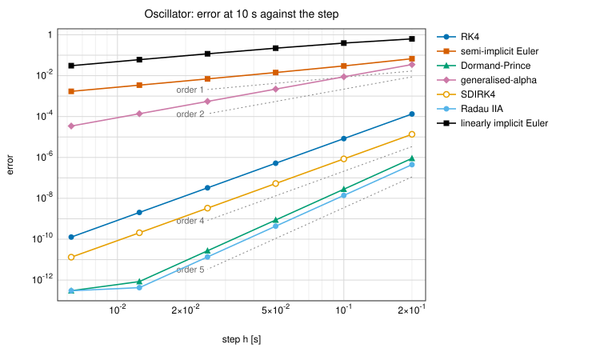
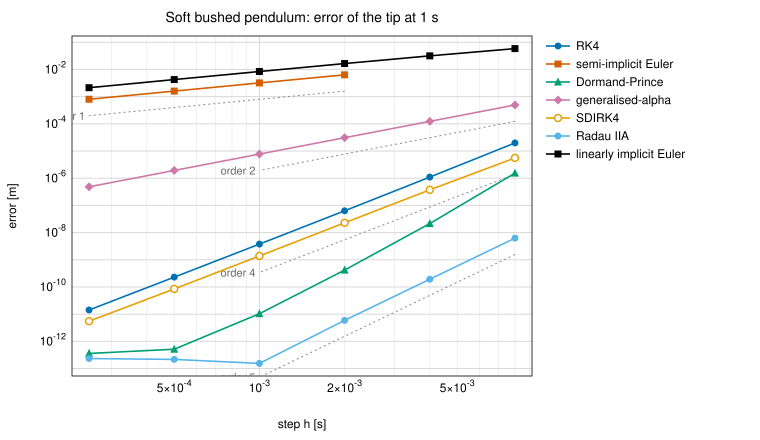
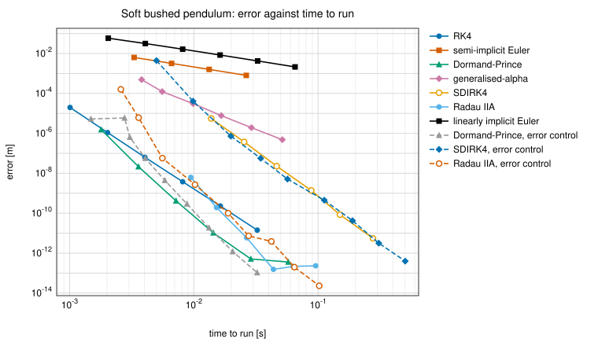
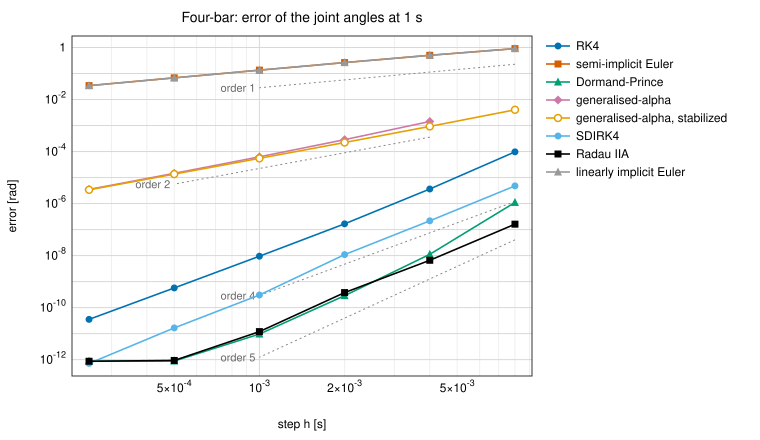
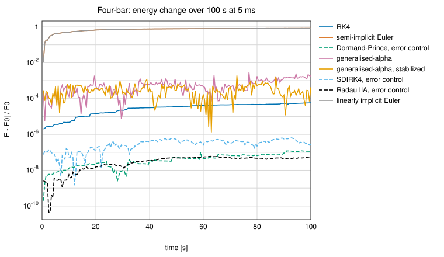
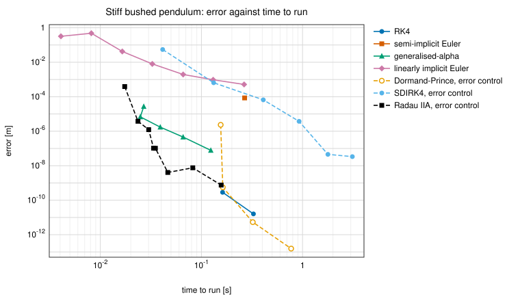
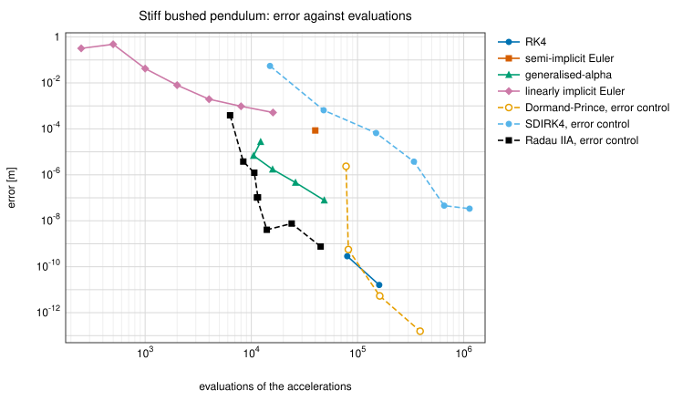
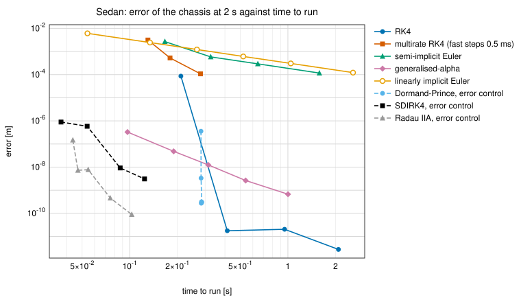

# The integrators, verified

Plan task 4.9: what each of the kernel's integrators does, measured. The
order each converges at, how its energy behaves over long runs, and what a
given accuracy costs with it, on six models from an oscillator with an exact
solution to the double-wishbone sedan. How to use the integrators, and which
to choose, is in [the kernel](kernel.md#forces-and-simulation); why each is
built as it is, in decisions D30 to D41
(`documentation/decisions.md`).

Every figure and table here comes from one program,
`bench/verify_integrators.cpp` (D41):

```powershell
scripts\build.ps1 -Target mbd_verify
build\bench\mbd_verify.exe docs\integrators        # all six models
build\bench\mbd_verify.exe docs\integrators sedan  # or some of them
```

It writes the figures (SVG) and the data of every run (CSV, with its
evaluations, steps, Newton iterations and time) into
[`docs/integrators/`](integrators/), and prints the tables. The times are
wall-clock times of the stepping alone, run pinned to one performance core
at high priority (D21), on the development laptop (i7-13700H, Windows 11,
MSVC, RelWithDebInfo); compare them with each other, not with another
machine. The whole run takes about two minutes. Raw output of the run
quoted here: `documentation/journal/data/2026-10-19_integrators-verified.md`.

## Summary

| Method | Order, measured | Energy of a conservative model | What limits its step | Cheapest for |
|---|---|---|---|---|
| `RK4` | 4 (4.00 on the oscillator; on the spatial models 4.0 at the shortest steps, up to 4.7 at the longest) | Loses \|R(iwh)\|^2 = 1 - (wh)^6/72 + ... per step: 1.4e-4 in 1000 s at wh = 0.1 | Stability: \|lambda h\| below about 2.7 for the fastest motion; on the sedan the wheel spins (1 ms is the edge) | Smooth models at moderate accuracy |
| `SemiImplicitEuler` | 1 | Without loops or spin: a modified energy kept exactly (the energy oscillates within 1 / (1 +- wh/2)); with them (D38): strongly dissipative | Explicit forces and damping: (wh)^2 < 4 - 4 zeta wh | Nothing measured here |
| `DormandPrince` | 5 (5.00) | Loses \|R\|^2 per step: 5e-6 in 1000 s at wh = 0.1 | Stability, as RK4's; its step control finds the limit by rejections | Smooth models at tight accuracy |
| `GeneralizedAlpha` | 2 (2.00) | Damped as rho_infinity sets: 1.4e-3 in 1000 s at wh = 0.1 | Newton's convergence at the longest steps (4 ms on the stiff pendulum, 10 ms on the sedan) | Stiff models at modest accuracy, fixed steps |
| `SDIRK4` | 4 on smooth models (4.0); loses it beside stiff bushings (stage order 1) | Loses \|R\|^2 per step: 5e-7 in 1000 s | Its error control | The sedan (its stiffness in the wheel spins, first-order states) |
| `RadauIIA` | 5 (5.0) | Loses \|R\|^2 per step: 3e-6 in 1000 s | Its error control | Stiff mechanical models at any accuracy |
| `LinearlyImplicitEuler` | 1 | Backward Euler's: (1 + (wh)^2)^(-1/2) per step, strongly dissipative | Accuracy; on stiff springs between turning bodies, an energy gain at long steps (k h^2 / m above about 25) | Real time; about 1 cm on the sedan |

What the measurements show:

- **Every method converges at its order**, on the oscillator exactly and on
  the spatial models (free bodies, bushings, a closed loop) to within the
  next term. On the oscillator every method's energy after 1000 s equals the
  one its own recurrence predicts, to 3e-11 or better (a test keeps this).
- **The step limits follow from the eigenvalues.** The explicit methods
  diverge where their stability regions predict from the fastest motion in
  each model's linearisation (sections 2 and 5); the motions out of the
  plane of the pendulums' swing are never excited.
- **Stiff mechanical models: Radau IIA with error control** was the cheapest
  at every accuracy on the stiff pendulum (17 ms of computing for 1e-3 m,
  47 ms for 1e-7 m, against 25 and 124 ms for generalised-alpha), and SDIRK4
  the dearest (order reduction, D33).
- **The sedan: the implicit methods with error control** take one step per
  10 ms output step on this drive and reach 1e-7 m in 37 to 44 ms of
  computing for 2 s of driving; the explicit methods are held to about 1 ms
  by the wheel spins (RK4: 211 ms at 1 ms, its error there 8.6e-5 m against
  1.8e-11 m at 0.5 ms). Generalised-alpha at 5 ms: 3.3e-7 m in 97 ms. The
  linearly implicit step: 1.2 mm at 1 ms, 6 mm at 5 ms in 54 ms.
- **Found and fixed (D40):** the linearly implicit step diverged on stiff
  bushings that carry a large rotation, because it kept only the symmetric
  part of the force derivatives. It now takes them whole.
- **Found and documented:** the linearly implicit step still gains energy
  on very stiff springs between turning bodies at long steps (section 5);
  generalised-alpha's Newton fails at the longest steps on the stiff
  pendulum, the four-bar and the sedan; the four-bar with its pendulum is
  chaotic, so its long runs depend on rounding (section 3).

## 1. The oscillator

A 1 kg block on a slider with a spring of 1 N/m (w = 1 rad/s), released at
rest from q = 1 m: q = cos t, v = -sin t. On a linear system a Runge-Kutta
step multiplies w = q - i v by its stability function R(i w h), so every
method's state after N steps is known in closed form: R^N for RK4,
Dormand-Prince, SDIRK4, Radau IIA (from their coefficients) and the
linearly implicit step (backward Euler, 1 / (1 - z)); generalised-alpha and
semi-implicit Euler by their recurrences. The methods with error control run
at fixed steps here, Newton at 1e-12.



Error |(q, v) - (cos t, -sin t)| at t = 10 s:

| method | 200 ms | 100 ms | 50 ms | 25 ms | 12.5 ms | 6.25 ms | observed orders |
|---|---|---|---|---|---|---|---|
| RK4 | 1.33e-4 | 8.33e-6 | 5.21e-7 | 3.26e-8 | 2.03e-9 | 1.27e-10 | 4, 4, 4, 4, 4 |
| semi-implicit Euler | 0.0674 | 0.0300 | 0.0142 | 0.00695 | 0.00344 | 0.00171 | 1.17, 1.07, 1.03, 1.02, 1.01 |
| Dormand-Prince | 9.01e-7 | 2.79e-8 | 8.69e-10 | 2.71e-11 | 8.46e-13 | 3.01e-13 | 5.01, 5, 5, 5, (rounding) |
| generalised-alpha | 0.0350 | 0.00879 | 0.00220 | 5.50e-4 | 1.38e-4 | 3.44e-5 | 1.99, 2, 2, 2, 2 |
| SDIRK4 | 1.35e-5 | 8.46e-7 | 5.29e-8 | 3.31e-9 | 2.07e-10 | 1.32e-11 | 4, 4, 4, 4, 3.97 |
| Radau IIA | 4.44e-7 | 1.39e-8 | 4.34e-10 | 1.36e-11 | 4.26e-13 | 3.02e-13 | 5, 5, 5, 4.99, (rounding) |
| linearly implicit Euler | 0.630 | 0.393 | 0.221 | 0.117 | 0.0606 | 0.0308 | 0.68, 0.83, 0.91, 0.96, 0.98 |

The fifth-order methods reach rounding (3e-13 over 1600 steps) at the
shortest step. The linearly implicit step approaches first order from
below: its error is mostly the amplitude it damps away, (1 + h^2)^(-N/2).

Energy E / E0 after 1000 s, measured, and predicted by each method's
recurrence; and the least and largest over the run:

| method | w h | steps | measured | predicted | relative difference | least, largest |
|---|---|---|---|---|---|---|
| RK4 | 0.1 | 10000 | 0.9998612943 | 0.9998612943 | 4.8e-13 | 0.999861, 1 |
| semi-implicit Euler | 0.1 | 10000 | 0.9872042584 | 0.9872042584 | 0 | 0.952381, 1.05263 |
| Dormand-Prince | 0.1 | 10000 | 0.9999945069 | 0.9999945069 | 1.2e-13 | 0.999995, 1 |
| generalised-alpha | 0.1 | 10000 | 0.9986330780 | 0.9986330780 | 2.2e-16 | 0.998605, 1 |
| SDIRK4 | 0.1 | 10000 | 0.9999994598 | 0.9999994598 | 1.1e-12 | 0.999999, 1 |
| Radau IIA | 0.1 | 10000 | 0.9999972239 | 0.9999972239 | 4.7e-13 | 0.999997, 1 |
| linearly implicit Euler | 0.1 | 10000 | 6.113e-44 | 6.113e-44 | 2.8e-11 | 6.1e-44, 1 |
| RK4 | 0.5 | 2000 | 0.6567127219 | 0.6567127219 | 6.5e-14 | 0.656713, 1 |
| semi-implicit Euler | 0.5 | 2000 | 1.332483674 | 1.332483674 | 0 | 0.8, 1.33333 |
| Dormand-Prince | 0.5 | 2000 | 0.9874665900 | 0.9874665900 | 3.9e-13 | 0.987467, 1 |
| generalised-alpha | 0.5 | 2000 | 0.8519102662 | 0.8519102662 | 2.6e-15 | 0.85191, 1 |
| SDIRK4 | 0.5 | 2000 | 0.9984795071 | 0.9984795071 | 8.4e-13 | 0.99848, 1 |
| Radau IIA | 0.5 | 2000 | 0.9914855184 | 0.9914855184 | 1.3e-13 | 0.991486, 1 |
| linearly implicit Euler | 0.5 | 2000 | 1.513e-194 | 1.513e-194 | 1.1e-11 | 1.5e-194, 1 |

- The Runge-Kutta methods lose energy as |R(i w h)|^2 per step; RK4's is
  1 - (wh)^6 / 72 + (wh)^8 / 576: 1.4e-8 a step at wh = 0.1, a third of
  the energy in 2000 steps at wh = 0.5.
- **Semi-implicit Euler is symplectic** on this model: it keeps q^2 + v^2 -
  h q v exactly, so its energy only oscillates, between 1 / (1 + h / 2)
  and 1 / (1 - h / 2) of the start (0.952 and 1.053 at h = 0.1; 0.8 and
  1.333 at 0.5, reached). On models with velocity products or loops it is
  not (D38; sections 3 and 4).
- **Generalised-alpha** damps as rho_infinity = 0.8 sets: a little at wh =
  0.1, 15 % in 1000 s at 0.5.
- **The linearly implicit step damps hard**: backward Euler's (1 +
  (wh)^2)^(-1/2) per step, about half the energy every period at wh = 0.1.
  That makes it stable at any step and suits real time, not long accurate
  runs of lightly damped motions.

## 2. The soft bushed pendulum: a smooth spatial model

Two 1 kg links, 1 m long, each on a free joint (a quaternion), held at the
hinges by bushings (`tests/kernel/bushed_pendulum.hpp`) of 1e4 N/m and 1e2
N m/rad, the hinge axis free, damped at a ratio of about 0.2; released
level, it swings in its plane for 1 s. Its linearisation at release: the
fastest motions 1.4e4 and 2.1e3 rad/s (overdamped, out of the plane of the
swing, which the motion never leaves, so never excited), then 297 rad/s at
a damping ratio of 0.6, in the plane. Reference: Dormand-Prince at
tolerance 1e-13 (40310 evaluations); Radau IIA at 1e-12 differs from it by
2.6e-14 m.



Error of the tip at 1 s [m], fixed steps (implicit methods: Newton at
1e-12):

| method | 8 ms | 4 ms | 2 ms | 1 ms | 0.5 ms | 0.25 ms | observed orders |
|---|---|---|---|---|---|---|---|
| RK4 | 1.98e-5 | 1.10e-6 | 6.32e-8 | 3.77e-9 | 2.30e-10 | 1.42e-11 | 4.17, 4.12, 4.07, 4.04, 4.01 |
| semi-implicit Euler | diverged | diverged | 0.00636 | 0.00319 | 0.00160 | 8.01e-4 | 0.99, 1.00, 1.00 |
| Dormand-Prince | 1.54e-6 | 2.15e-8 | 4.17e-10 | 1.04e-11 | 5.13e-13 | 3.59e-13 | 6.2, 5.7, 5.3, 4.3, (rounding) |
| generalised-alpha | 4.92e-4 | 1.23e-4 | 3.09e-5 | 7.72e-6 | 1.93e-6 | 4.83e-7 | 2, 2, 2, 2, 2 |
| SDIRK4 | 5.57e-6 | 3.74e-7 | 2.29e-8 | 1.38e-9 | 8.45e-11 | 5.51e-12 | 3.9, 4.03, 4.05, 4.03, 3.94 |
| Radau IIA | 6.26e-9 | 1.92e-10 | 5.92e-12 | 1.54e-13 | 2.16e-13 | 2.33e-13 | 5.02, 5.02, 5.26, (rounding) |
| linearly implicit Euler | 0.0584 | 0.0316 | 0.0165 | 0.00840 | 0.00424 | 0.00213 | 0.89, 0.94, 0.97, 0.99, 0.99 |

**Semi-implicit Euler's limit, derived.** Its forces, damping included, are
explicit: for a motion of frequency w and damping ratio zeta its step's
matrix has determinant 1 - a and trace 2 - a - b, with a = 2 zeta w h and b
= (w h)^2, and is stable while b < 4 - 2a. For the in-plane motion (297
rad/s, 0.6): at 4 ms a = 1.43 and b = 1.41 > 4 - 2a = 1.15, unstable; at 2
ms a = 0.71 and b = 0.35, stable; as measured. RK4 is stable at 8 ms there
(|lambda h| = 2.4, inside its region).



The cheapest run within each error (time for 1 s of motion; evaluations):

| method | error <= 1e-3 m | <= 1e-6 m | <= 1e-9 m |
|---|---|---|---|
| RK4 | 1.0 ms (8 ms, 500) | 4.0 ms (2 ms, 2000) | 16 ms (0.5 ms, 8000) |
| Dormand-Prince | 1.8 ms (8 ms, 875) | 3.6 ms (4 ms, 1750) | 7.2 ms (2 ms, 3500) |
| Dormand-Prince, error control | 1.5 ms (tol 1e-3, 720) | 3.1 ms (tol 1e-5, 1518) | 8.8 ms (tol 1e-8, 4447) |
| Radau IIA | 9.5 ms (8 ms, 3702) | 9.5 ms (8 ms, 3702) | 15 ms (4 ms, 5880) |
| Radau IIA, error control | 2.6 ms (tol 1e-3, 932) | 5.6 ms (tol 1e-5, 1983) | 19 ms (tol 1e-7, 5506) |
| generalised-alpha | 3.8 ms (8 ms, 1640) | 52 ms (0.25 ms, 19661) | - |
| SDIRK4 | 14 ms (8 ms, 5566) | 25 ms (4 ms, 10119) | 150 ms (0.5 ms, 59949) |
| SDIRK4, error control | 9.9 ms (tol 1e-4, 3570) | 20 ms (tol 1e-5, 7284) | 112 ms (tol 1e-8, 41242) |
| semi-implicit Euler | 26 ms (0.25 ms, 4000) | - | - |
| linearly implicit Euler | - | - | - |

On a smooth model the explicit high-order methods win, Dormand-Prince at
every accuracy; Radau IIA with error control is within a factor of two to
three of it. Generalised-alpha and the first-order methods are not for
accuracy.

## 3. The four-bar with its pendulum: a closed loop

The planar four-bar of the tests (`tests/kernel/four_bar.hpp`) closed in
3D (5 equations of rank 2) with a pendulum on its coupler, the crank turning
at 2 rad/s from 1 rad; no damping and no force elements, so the
semi-implicit and linearly implicit steps are the same method here. Every
method projects after its steps; generalised-alpha also in its stabilized
index-2 form (D37). Its linearisation: nothing faster than 9 rad/s.
Reference: Dormand-Prince at tolerance 1e-13; Radau IIA at 1e-12 differs by
2.2e-13 rad.



Error of the joint angles at 1 s [rad]:

| method | 8 ms | 4 ms | 2 ms | 1 ms | 0.5 ms | 0.25 ms | observed orders |
|---|---|---|---|---|---|---|---|
| RK4 | 9.73e-5 | 3.63e-6 | 1.66e-7 | 9.47e-9 | 5.71e-10 | 3.53e-11 | 4.74, 4.45, 4.13, 4.05, 4.01 |
| semi-implicit Euler | 0.907 | 0.502 | 0.263 | 0.135 | 0.0681 | 0.0343 | 0.85, 0.93, 0.97, 0.98, 0.99 |
| Dormand-Prince | 1.11e-6 | 1.12e-8 | 2.88e-10 | 9.63e-12 | 8.85e-13 | 8.74e-13 | 6.6, 5.3, 4.9, (rounding) |
| generalised-alpha | Newton failed (K058) | 0.00143 | 2.87e-4 | 6.27e-5 | 1.46e-5 | 3.50e-6 | 2.32, 2.19, 2.11, 2.06 |
| generalised-alpha, stabilized | 0.00402 | 9.26e-4 | 2.23e-4 | 5.48e-5 | 1.36e-5 | 3.38e-6 | 2.12, 2.05, 2.03, 2.01, 2.01 |
| SDIRK4 | 4.78e-6 | 2.17e-7 | 1.09e-8 | 3.06e-10 | 1.66e-11 | 7.16e-13 | 4.5, 4.3, 5.2, 4.2, 4.5 |
| Radau IIA | 1.61e-7 | 6.60e-9 | 3.78e-10 | 1.19e-11 | 9.31e-13 | 8.65e-13 | 4.6, 4.1, 5.0, (rounding) |
| linearly implicit Euler | as semi-implicit Euler | | | | | | |

The projection keeps every one-step method's order (Eich-Soellner and
Führer, 5.3). Generalised-alpha projected fails Newton at 8 ms with its
tolerance at 1e-12, and runs at 1e-9 (error 7.9e-3 rad); the stabilized form
runs at 8 ms and is 1.0 to 1.5 times more accurate where both run (D37).



Energy over 100 s, relative to the start (17.83 J): at the end, and the
largest change on the way; the methods with error control at tolerance
1e-6 within each output step:

| method | 5 ms: at 100 s | largest | 1 ms: at 100 s | largest |
|---|---|---|---|---|
| RK4 | -5.78e-5 | -5.78e-5 | -3.33e-8 | -3.48e-8 |
| semi-implicit and linearly implicit Euler | -0.822 | -0.822 | -0.528 (see below) | -0.567 |
| Dormand-Prince, error control | +1.11e-7 | +1.94e-7 | -2.65e-11 | -3.31e-11 |
| generalised-alpha | -0.0018 | -0.0043 | +1.0e-4 | -1.2e-4 |
| generalised-alpha, stabilized | -4.2e-4 | -0.0030 | -5.0e-5 | -1.8e-4 |
| SDIRK4, error control | +2.7e-7 | +7.0e-7 | +4.8e-8 | +5.2e-8 |
| Radau IIA, error control | -5.3e-8 | -6.1e-8 | -3.8e-9 | -3.8e-9 |

- The two Euler steps take the inertia's velocity products implicitly and
  put the new velocities on the constraints (D38): on a loop they only
  lose energy (never above the start), and fast: four fifths of it in 100
  s at 5 ms.
- **The motion is chaotic at this energy.** The same run at 1 ms with the
  mass matrix factorized densely instead of along the tree (D39), which
  differs only by rounding (1e-15), agrees with it to six digits for 20 s
  and then separates (the crank at 40 s: -2.02 against -3.24 rad); it ends
  at -0.638, D38's figure for this model, where this run ends at -0.528.
  At 5 ms, where the energy falls faster, the two agree to six digits
  throughout. Long runs of this model compare methods only in their size.

## 4. The heavy top: gyroscopic terms on a constraint

A flat 1 kg disc 0.2 m across on a free joint, its tip held at the origin by
a spherical closure 0.1 m below its centre, tilted 0.5 rad and spinning at
30 rad/s (energy 3.861 J); no damping. It nutates at about 15 rad/s and
precesses.

| method | 5 ms: energy at 100 s | largest | spin | 1 ms: energy at 100 s | largest | spin |
|---|---|---|---|---|---|---|
| RK4 | -3.74e-5 | -3.74e-5 | 30 | -3.49e-8 | -3.49e-8 | 30 |
| semi-implicit and linearly implicit Euler | -0.477 | -0.477 | 30 | -0.477 | -0.477 | 30 |
| Dormand-Prince, error control | -1.02e-6 | -1.02e-6 | 30 | -3.18e-10 | -3.18e-10 | 30 |
| generalised-alpha (both forms) | -7.15e-4 | -1.0e-3 | 30 | -5.33e-6 | -1.91e-5 | 30 |
| SDIRK4, error control | -3.59e-6 | -3.59e-6 | 30 | +5.6e-9 | +5.9e-9 | 30 |
| Radau IIA, error control | -1.30e-6 | -1.30e-6 | 30 | -3.25e-9 | -3.25e-9 | 30 |

- **The Euler steps remove the nutation and keep the spin**: 0.477 of the
  energy (1.842 J, the nutation's) at both steps, the spin at 30 rad/s, a
  steady precession left (D38).
- **Generalised-alpha's two forms agree to twelve digits** (3.8581470925 J
  at 100 s at 5 ms, the same Newton iterations): projected, its steps leave
  the tip's constraint by at most 7.7e-15 m, so there is nothing for the
  stabilized form to correct (9.1e-17 m). The difference D37 measured is on
  the four-bar, whose loop the method's lagging acceleration leaves far.

## 5. The stiff bushed pendulum

The pendulum of section 2 with bushings of 1e8 N/m and 1e6 N m/rad: the
hinges are nearly joints. Its linearisation: 1.4e6 and 2.1e5 rad/s
(overdamped, out of the plane, never excited), then 2.97e4 rad/s at a
damping ratio of 0.6 in the plane, beside the swing at about 5 rad/s.
Reference: Dormand-Prince at tolerance 1e-13 (1.54 million evaluations);
Radau IIA at 1e-12 differs by 2.3e-13 m. Newton at 1e-9 for the methods
without error control (at 1e-12 generalised-alpha failed at 2 ms as well).





The cheapest run within each error (time for 1 s of motion; evaluations):

| method | error <= 1e-3 m | <= 1e-5 m | <= 1e-7 m |
|---|---|---|---|
| Radau IIA, error control | 17 ms (tol 1e-3, 6310) | 24 ms (tol 1e-4, 8399) | 47 ms (tol 1e-8, 13986) |
| generalised-alpha | 25 ms (1 ms, 10488) | 25 ms (1 ms, 10488) | 124 ms (0.125 ms, 48596) |
| linearly implicit Euler | 131 ms (0.125 ms, 8000) | - | - |
| SDIRK4, error control | 132 ms (tol 1e-4, 47995) | 924 ms (tol 1e-6, 339742) | 1780 ms (tol 1e-7, 654372) |
| Dormand-Prince, error control | 155 ms (tol 1e-4, 77952) | 155 ms (tol 1e-4, 77952) | 163 ms (tol 1e-6, 81956) |
| RK4 | 162 ms (50 us, 80000) | 162 ms (50 us, 80000) | 162 ms (50 us, 80000) |
| semi-implicit Euler | 267 ms (25 us, 40000) | - | - |

Every run, with its evaluations, steps, rejections and Newton iterations,
is in [`integrators/stiff.csv`](integrators/stiff.csv). What they show:

- **Radau IIA with error control is the cheapest at every accuracy**, and
  meets tight errors that generalised-alpha needs very short steps for.
- **The explicit methods sit at their stability limits**, which the
  in-plane motion predicts: RK4 diverges at 100 us (|lambda h| = 3.0) and
  runs at 50 us (1.5); semi-implicit Euler diverges at 50 us (a = 1.78, b =
  2.2 > 4 - 2a) and runs at 25 us. Dormand-Prince's step control finds its
  limit by rejections (2730 at tolerance 1e-4) and takes about 80000
  evaluations at any tolerance down to 1e-6; at tight errors that is still
  cheaper than SDIRK4.
- **SDIRK4 loses its order** beside the bushings (stage order 1, D33): 1.1
  million evaluations for 3.4e-8 m.
- **Generalised-alpha** is second order (6.8e-6 m at 1 ms, 1.7e-6 at 0.5
  ms) and fails Newton at 4 ms.
- **The linearly implicit step** (after D40, below): bounded at every step
  from 4 ms to 62.5 us, but first order only from 0.25 ms (errors 0.32,
  0.48, 0.042, 0.0080, 0.0020, 9.6e-4 and 5.2e-4 m at 4, 2, 1, 0.5, 0.25,
  0.125 and 0.0625 ms).

**Found: the linearly implicit step diverged here (D40).** Before this task
it diverged within the first second at 2, 1 and 0.5 ms. A probe showed the
bushings' rotational stiffness deciding it (at 1e2 N m/rad even 1e8 N/m ran
at 2 ms; at 1e6 N m/rad even 1e6 N/m diverged), and the force derivatives
right (equal to differences of the whole generalized forces to 5e-8 without
damping) but far from symmetric: an antisymmetric part of 1.46e6 against
5.6e8 after 0.3 s, a bushing's rotational stiffness, carrying the links'
large relative rotation about the free axis, coupling its other two axes by
about k_r times half the rotation. The step kept only the symmetric part
(D35, for a Cholesky); h^2 times the rest, 1.46 at 1 ms, outweighed the
links' inertia. It now takes the derivatives whole, through the LU solve
D38 introduced.

**Found: the linearly implicit step gains energy on very stiff springs at
long steps.** Released level, at rest and undeflected, the pendulum has no
energy to start with, and its dampers only take energy out, so kinetic plus
gravity's energy can never rise above zero. At 0.5 ms and below it does
not (at most -2.1e-5 J); at 1 ms it reaches +0.21 J and at 2 ms +8.6 J. One
linearization per step moves each attachment point along its tangent, the
true motion along an arc; the stiff translational spring turns their
second-order gap, about k L (w h)^2 / 2, into a force. The gain depends on
k h^2 alone: at 1e7 N/m only at 2 ms, at 1e6 N/m at no step measured; the
rotational stiffness plays no part. Generalised-alpha, whose Newton
iterations evaluate the forces where the step ends, does not have it. A
real-time model should keep k h^2 / m below about 25 for springs between
turning bodies, or make such hinges joints.

## 6. The sedan

The double-wishbone sedan with its drivetrain (27 velocities, 4 wheel spins
as states, 17 constraint equations), from its static equilibrium with
throttle 0.4 and the front wheels steered 0.02 rad, both held, for 2 s; the
error is the chassis's position at 2 s (it has driven 2.34 m). The
linearisation of its bodies shows nothing faster than 390 rad/s; the wheel
spins, which it does not include, relax at 2800 to 3100 /s at low speed
(task 4.3), and they hold the explicit methods to about 1 ms. Reference: RK4
at 0.05 ms; at 0.1 ms it differs by 2.8e-12 m. The methods with error
control step within output steps of 10 ms.



The cheapest run within each error (time for 2 s of driving; evaluations):

| method | error <= 1e-2 m | <= 1e-3 m | <= 1e-4 m | <= 1e-5 m |
|---|---|---|---|---|
| SDIRK4, error control | 37 ms (tol 1e-3, 1226) | 37 ms | 37 ms | 37 ms |
| Radau IIA, error control | 44 ms (tol 1e-3, 1461) | 44 ms | 44 ms | 44 ms |
| linearly implicit Euler | 54 ms (5 ms, 400) | 522 ms (0.5 ms, 4000) | - | - |
| generalised-alpha | 97 ms (5 ms, 3728) | 97 ms | 97 ms | 97 ms |
| multirate RK4 (fast steps 0.5 ms) | 130 ms (4 ms, 2000) | 180 ms (2 ms, 4000) | - | - |
| semi-implicit Euler | 167 ms (1 ms, 2000) | 325 ms (0.5 ms, 4000) | - | - |
| RK4 | 211 ms (1 ms, 8000) | 211 ms | 211 ms | 414 ms (0.5 ms, 16000) |
| Dormand-Prince, error control | 282 ms (tol 1e-4, 11915) | 282 ms | 282 ms | 282 ms |

- **On this drive the implicit methods with error control are the cheapest
  by far**: one step per output step (202 steps), 1.5e-7 m (Radau IIA) and
  8.9e-7 m (SDIRK4) at tolerance 1e-3, 37 to 44 ms for 2 s of driving, 50
  times faster than real time. The drive is smooth after its start; its
  stiffness is in the wheel spins, which these methods carry at any step.
- **The explicit methods are held to about 1 ms by the wheel spins.** RK4
  at 1 ms is on the edge: 8.6e-5 m, against 1.8e-11 m at 0.5 ms (task 4.3
  found it chattering there below the tyres' V_low). Dormand-Prince's step
  control keeps it near 1.4 ms whatever the tolerance (about 1460 steps,
  290 rejected). Multirate RK4 (D36) moves the bodies at 2 to 4 ms with
  fast steps of 0.5 ms for the spins: 3.1e-3 m at 4 ms, 5.3e-4 at 2 ms,
  1.1e-4 at 1 ms.
- **Generalised-alpha** at 5 ms: 3.3e-7 m in 97 ms; at 10 ms Newton fails.
- **The linearly implicit step and semi-implicit Euler** are first order
  (1.2e-3 m and 2.7e-3 m at 1 ms); the linearly implicit step is the
  cheapest way to centimetre accuracy (5 ms) and costs the same every step,
  which is what real time needs.

This drive has no events, braking or locking, which would cost the methods
with error control their long steps; the real-time comparison of single
steps is in [performance](performance.md#task-45-the-integrators-on-the-sedan-16-october-2026).

## Open ends

- The linearly implicit step's energy gain on very stiff springs between
  turning bodies at long steps (section 5): a second evaluation per step
  (one Newton iteration) would remove it at twice the cost.
- Its stiffness matrix leaves out how a body's velocity turns with its pose
  at fixed joint rates, about c |v| of a damper's stiffness (5e3 of 5.6e8
  on the stiff pendulum): not the cause of anything measured here.
- Generalised-alpha's Newton at its longest steps (4 ms on the stiff
  pendulum, 8 ms on the four-bar at a tight tolerance, 10 ms on the sedan).
- Manoeuvres with events (braking to a stop, wheels locking, contact) for
  the methods with error control.
